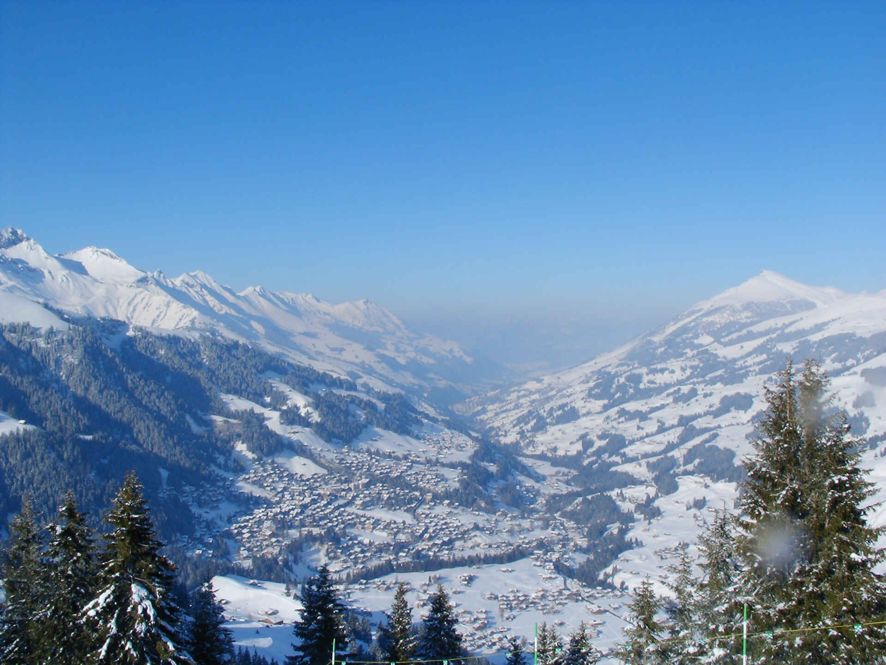

  
  

    
Ein Weltcup-Wochenende

    
Adelboden

    
9.–10. Januar 2027

  

Riesenslalom am Chuenisbärgli · warmes Wasser auf dem Heimweg

## Samstag, 9. Januar

Riesenslalom

| Zeit | Programm | Info | Buchen |
|---|---|---|---|
| 5.20 | Abfahrt Dielsdorf | → [Anreise](#anreise) | |
| 5.50 | Abfahrt Luzern | → [Anreise](#anreise) | |
| ca. 7.15 | [Strandhotel Seeblick](https://www.google.com/maps/search/?api=1&query=Strandhotel+Seeblick%2C+Interlakenstrasse+81%2C+3705+Faulensee) | Schlüssel im Couvert, Auto bleibt beim Hotel | gebucht, Voucher vorbezahlt |
| 7.30 | Faulensee-Shuttle ab Hotel | fährt nur 1×, Zeit provisorisch | CHF 19 |
| ca. 8.30 | [Zielgelände Chuenisbärgli](https://www.google.com/maps/search/?api=1&query=Chuenisb%C3%A4rgli%2C+Adelboden) | | Tickets vorhanden |
| 10.30 | Riesenslalom, 1. Lauf | | |
| 13.30 | 2. Lauf | | |
| ab 14.30 | Weltcup-Party | wir bleiben oben | |
| später | Zurück ins Hotel | → [Rückfahrt](#rueckfahrt) | |

### Rückfahrt nach der Party {#rueckfahrt}

| Option | Party bis | Weg | Im Hotel |
|---|---|---|---|
| **A** Abend | 23.00 | letzter Shuttle → P+R → Taxi | ca. 0.05 |
| **B** Lange Nacht | ca. 0.45 | Moonliner 1.00 → Spiez → Taxi | ca. 2.10 |
| **C** Taxi | beliebig | Taxi direkt, ca. 45 Min. | beliebig |

Check-in jederzeit mit Schlüssel-Couvert, alle Optionen möglich.

## Sonntag, 10. Januar

Warmes Wasser auf dem Heimweg

| Zeit | Programm | Info | Buchen |
|---|---|---|---|
| 9.00 | Frühstück im Hotel | Buffet 7.30–10.30 | CHF 22 pro Person |
| 11.00 | Check-out | mit Gepäck | |
| Mittag | Warmes Bad | → [Bäder](#baeder) | |
| ca. 17.00 | Heimfahrt | | |

### Bäder {#baeder}

| Umweg ab Luzern / Dielsdorf | Bad | Wasser | Besonders | |
|---|---|---|---|---|
| +25 / +35 Min. | [BEATUS, Merligen](https://www.google.com/maps/search/?api=1&query=Beatus+Wellness-+%26+Spa-Hotel%2C+Merligen) | ca. 35 °C | Seeblick | **[Day Spa](https://www.beatus.ch)** |
| +40 / +15 Min. | [Bernaqua, Bern](https://www.google.com/maps/search/?api=1&query=Bernaqua%2C+Riedbachstrasse+98%2C+3027+Bern) | 34–36 °C | CHF 48, Sauna +5 | **[Infos](https://www.bernaqua.ch)** |
| +75 / +10 Min. | [Bad Schinznach](https://www.google.com/maps/search/?api=1&query=Bad+Schinznach+Aquarena) | 36 °C | 50-m-Aussenbad | **[Infos](https://www.bad-schinznach.ch)** |
| +75 / +10 Min. | [FORTYSEVEN, Baden](https://www.google.com/maps/search/?api=1&query=FORTYSEVEN%2C+Baden) | 38 °C | Hot Pool | **[Infos](https://www.fortyseven.ch)** |
| +75 / +30 Min. | [Thermalbad Zürich](https://www.google.com/maps/search/?api=1&query=Thermalbad+%26+Spa+Z%C3%BCrich) | ca. 35 °C | Dachbad | **[Infos](https://www.thermalbad-zuerich.ch)** |
| +3 Std. | [Leukerbad](https://www.google.com/maps/search/?api=1&query=Leukerbad+Therme) | 36–43 °C | Autoverlad Lötschberg | **[Infos](https://leukerbad.ch/en/therme)** |

## Anreise

**Zuhause → Hotel**

| Ab | An | Von | Route |
|---|---|---|---|
| 5.20 | ca. 7.15 | Dielsdorf | [160 km](https://www.google.com/maps/dir/?api=1&origin=Dielsdorf&destination=Strandhotel+Seeblick%2C+Faulensee&travelmode=driving) |
| 5.50 | ca. 7.15 | Luzern | [85 km](https://www.google.com/maps/dir/?api=1&origin=Luzern&destination=Strandhotel+Seeblick%2C+Faulensee&travelmode=driving) |

**Hotel → Zielgelände**

| | **Faulensee-Shuttle ✓** | [P+R Reichenbach](https://www.weltcup-adelboden.ch/anreise) | Zug via Frutigen |
|---|---|---|---|
| Anfahrt | | Auto, Stau möglich | Bus/Auto → Bahnhof Spiez, Zug → Frutigen |
| Shuttle | CHF 19 einfach | im Rennticket | im Rennticket, ca. 40 Min. |
| Parkieren | beim Hotel | CHF 15 pro Tag | beim Hotel |
| Hinfahrt | 7.30 ab Hotel, nur 1× | 7.00–13.00 | 7.00–13.00, Extrazüge |
| Rückfahrt | 17.00 ab Adelboden, nur 1× | 14.30–23.00 | 14.30–23.00 bis Frutigen |
| Sonntag | Auto steht beim Hotel | Taxi zum P+R | Auto steht beim Hotel |
| Anmelden | bis 27. November, Mail ans Hotel | nicht nötig | nicht nötig |
| Route | | [Hotel → Reichenbach](https://www.google.com/maps/dir/?api=1&origin=Strandhotel+Seeblick%2C+Faulensee&destination=Flugplatz+Reichenbach+im+Kandertal&travelmode=driving) | [Hotel → Frutigen](https://www.google.com/maps/dir/?api=1&origin=Strandhotel+Seeblick%2C+Faulensee&destination=Bahnhof+Frutigen&travelmode=transit) |

## Wichtig zu wissen

**To-do**

| Bis | Aufgabe |
|---|---|
| ☐ 27. November | Shuttle per Mail ans Hotel: Sa, 2 Pers., nur Hinfahrt, Namen, E-Mail, Handy |
| ☐ bald | Voucher vorbezahlen → Schlüssel-Couvert |
| ☐ bald | Hotel: Kreditkarte als Garantie, wie ohne Reception? |
| ☑ | Auto beim Hotel parkieren: kein Problem |

**Hotel**

| Was | Info |
|---|---|
| Name | [Strandhotel Seeblick](https://www.seeblick.ch) |
| Adresse | Interlakenstrasse 81, Faulensee |
| Telefon | +41 33 655 60 80 |
| E-Mail | info@seeblick.ch |
| Check-in | jederzeit, Schlüssel im Couvert |
| Garantie | Kreditkarte vorzeigen (Booking.com) |
| Check-out | Sonntag bis 12.00 |
| Stornieren | gratis bis 1. Januar 2027 |

**Unterwegs**

| Was | Info |
|---|---|
| Rennticket | offline auf dem Handy |
| Moonliner | Spezialticket, nur Option B |
| Taxi Spiez | Tagsi AG, +41 33 222 22 22 |

**Packliste**

| Was | Wofür |
|---|---|
| Skihose, warme Schuhe, Mütze, Handschuhe | stundenlang im Schnee stehen |
| Kleiner Rucksack | Samstag ohne Gepäck unterwegs |
| Badesachen, Badetuch, Badeschuhe | Sonntag |
| Eiskratzer | Auto |
| Powerbank | Tickets und SBB-App, Akkus leeren sich in der Kälte |

Bilder: Wikimedia Commons · Zielgelände © Chris Schaer, CC BY-SA 2.0 · Adelboden © Firasco, CC BY-SA 3.0 · Spiez und Faulensee © Marco Beierer, CC BY-SA 3.0
