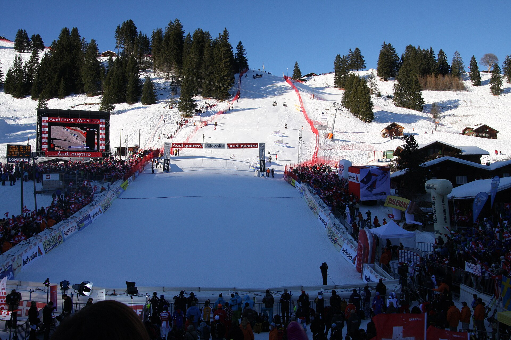
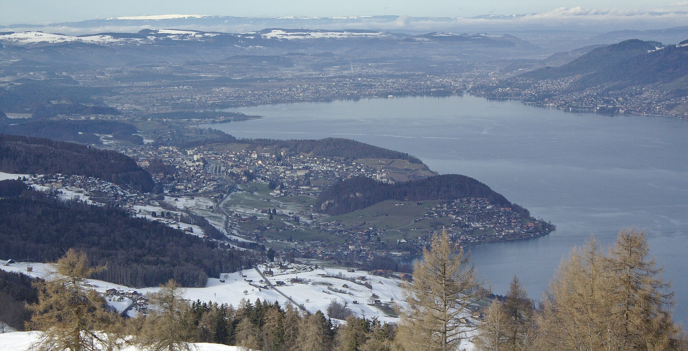

  
  

    
Ein Weltcup-Wochenende

    
Adelboden

    
9.–10. Januar 2027

  

Riesenslalom am Chuenisbärgli · warmes Wasser auf dem Heimweg

## Samstag, 9. Januar

Riesenslalom

| Zeit | Programm | Info | Buchen |
|---|---|---|---|
| 6.15 | Abfahrt | ab Luzern · ab Dielsdorf 5.55 → [Anreise](#anreise) | |
| 7.50 | [Strandhotel Seeblick](https://www.google.com/maps/search/?api=1&query=Strandhotel+Seeblick%2C+Interlakenstrasse+81%2C+3705+Faulensee) | Gepäck und Auto abgeben · Check-in erst ab 16.00 · darf das Auto nicht bleiben: weiter zum P+R Reichenbach → [Anreise](#anreise) | gebucht, 2 Personen |
| 8.08 | Bus, Zug, Shuttle | ca. 1 Std. 30 ins Zielgelände → [Anreise](#anreise) | |
| 9.35 | [Zielgelände Chuenisbärgli](https://www.google.com/maps/search/?api=1&query=Chuenisb%C3%A4rgli%2C+Adelboden) | | Tickets vorhanden |
| 10.30 | Riesenslalom, 1. Lauf | | |
| 13.30 | 2. Lauf | | |
| ab 14.30 | Weltcup-Party | wir bleiben oben, kein Hin und Her ins Hotel | |
| je nach Option | Zurück ins Hotel | 4 Optionen, je nach Antwort des Hotels → [Rückfahrt](#rueckfahrt) | |

### Rückfahrt nach der Party {#rueckfahrt}

Optionen A und B: Shuttle Zielgelände → Frutigen (ca. 45 Min., letzter 23.00), Zug Frutigen → Spiez (xx.30, letzter ca. 23.00), Taxi Spiez → Faulensee (4 Min.). Option C: Moonliner ab Adelboden. Option D fährt direkt.

| Option | Party bis | Shuttle ab | Weiter | Im Hotel | Braucht vom Hotel |
|---|---|---|---|---|---|
| A · Früh | ca. 17.30 | ca. 17.30 | Zug 18.30 → Spiez 18.44 · Taxi | ca. 18.55 | nichts, normaler Check-in bis 19.00 |
| B · Abend | ca. 21.30 | ca. 21.30 | Zug 22.30 → Spiez 22.44 · Taxi | ca. 23.00 | Check-in ca. 23.00 |
| C · Lange Nacht | ca. 0.45 | – | Moonliner M45 1.00 ab Adelboden, Post → Spiez 1.55 · Taxi | ca. 2.10 | Check-in ca. 2.10 |
| D · Taxi direkt | beliebig | – | Taxi Adelboden → Faulensee, ca. 45 Min. | beliebig | Check-in zur passenden Zeit |

**Je nach Antwort des Hotels**

| Hotel sagt | Dann |
|---|---|
| Check-in jederzeit möglich (Nachtportier, Schlüsselbox oder Code) | Option C oder D, je nach Lust |
| Check-in bis ca. 23.00 | Option B |
| Check-in nur bis 19.00 | Option A |

## Sonntag, 10. Januar

Warmes Wasser auf dem Heimweg

| Zeit | Programm | Info | Buchen |
|---|---|---|---|
| 9.00 | Frühstück im Hotel | CHF 22 pro Person | |
| 11.00 | Check-out | | |
| Mittag | Warmes Bad | → [Bäder](#baeder) | |
| ca. 17.00 | Heimfahrt | | |

### Bäder {#baeder}

| Umweg ab Luzern / Dielsdorf | Bad | Wasser | |
|---|---|---|---|
| +25 / +35 Min. | [BEATUS, Merligen](https://www.google.com/maps/search/?api=1&query=Beatus+Wellness-+%26+Spa-Hotel%2C+Merligen) | Aussen-Solebad ca. 35 °C · Blick auf den See | **[Day Spa](https://www.beatus.ch)** |
| +40 / +15 Min. | [Bernaqua, Bern](https://www.google.com/maps/search/?api=1&query=Bernaqua%2C+Riedbachstrasse+98%2C+3027+Bern) | Solebäder 34–36 °C · Sauna +CHF 5 · CHF 48 | **[Infos](https://www.bernaqua.ch)** |
| +75 / +10 Min. | [Bad Schinznach](https://www.google.com/maps/search/?api=1&query=Bad+Schinznach+Aquarena) | Thermalwasser 36 °C · 50-m-Aussenbad | **[Infos](https://www.bad-schinznach.ch)** |
| +75 / +10 Min. | [FORTYSEVEN, Baden](https://www.google.com/maps/search/?api=1&query=FORTYSEVEN%2C+Baden) | Hot Pool 38 °C | **[Infos](https://www.fortyseven.ch)** |
| +75 / +30 Min. | [Thermalbad Zürich](https://www.google.com/maps/search/?api=1&query=Thermalbad+%26+Spa+Z%C3%BCrich) | Dachbad ca. 35 °C · Blick über die Stadt | **[Infos](https://www.thermalbad-zuerich.ch)** |
| +3 Std. | [Leukerbad](https://www.google.com/maps/search/?api=1&query=Leukerbad+Therme) | 36–43 °C · Autoverlad Lötschberg | **[Infos](https://leukerbad.ch/en/therme)** |

## Anreise

**Samstag · Zuhause → Hotel** · [Route ab Luzern](https://www.google.com/maps/dir/?api=1&origin=Luzern&destination=Strandhotel+Seeblick%2C+Faulensee&travelmode=driving) · [Route ab Dielsdorf](https://www.google.com/maps/dir/?api=1&origin=Dielsdorf&destination=Strandhotel+Seeblick%2C+Faulensee&travelmode=driving)

| Ab | An | Verbindung | Info |
|---|---|---|---|
| 6.15 | ca. 7.40 | Auto ab Luzern | ca. 85 km |
| 5.55 | ca. 7.50 | Auto ab Dielsdorf | ca. 160 km |

**Plan B · Auto nicht im Hotel** · Gepäck im Hotel abgeben, dann mit dem Auto zum offiziellen Weltcup-Parkplatz [P+R Reichenbach](https://www.google.com/maps/search/?api=1&query=Reichenbach+im+Kandertal) (an der Strasse Spiez–Frutigen) und von dort mit dem Weltcup-Shuttle direkt ins Zielgelände, ca. 45 Min. In Adelboden gibt es am Wochenende keine Parkplätze. → [Anreise Weltcup](https://www.weltcup-adelboden.ch/anreise)

| Was | Info |
|---|---|
| Preis | CHF 15 pro Auto und Tag · Vorverkauf nicht bekannt, vermutlich vor Ort |
| Shuttle | im Rennticket inbegriffen · hin 7.00–13.00 · zurück zum P+R 14.30–23.00 |
| Über Nacht | unklar, beim Weltcup-Büro fragen · vermutlich 2 × CHF 15 |
| Sonntag | Auto holen: Zug Spiez → Reichenbach i. K., dann zum P+R |
| Strom | 10 Ladestationen, ohne Reservation |

**Samstag · Hotel → Zielgelände** · [Route](https://www.google.com/maps/dir/?api=1&origin=Faulensee&destination=Chuenisb%C3%A4rgli%2C+Adelboden&travelmode=transit)

| Ab | An | Verbindung | Info |
|---|---|---|---|
| 8.08 | 8.17 | Bus 60 Faulensee, Dorf → Spiez, Bahnhof | |
| 8.32 | 8.45 | Zug Spiez → Frutigen | |
| ca. 8.50 | ca. 9.35 | Weltcup-Shuttle → Zielgelände | ab Bahnhof Frutigen · fährt 7.00–13.00 |

**Samstag · Zielgelände → Hotel** · Optionen A–D → [Rückfahrt](#rueckfahrt)

**Tickets · SBB-App**

| Fahrt | Ticket | Gilt für |
|---|---|---|
| Samstag | Faulensee → Frutigen · einfach bei Option C/D, sonst retour · 2 Personen | Bus 60, Zug |
| Partynacht | Moonliner · 2 Personen · nur bei Option C | nur M45 |

## Wichtig zu wissen

| Was | Info |
|---|---|
| Hotel | [Strandhotel Seeblick](https://www.seeblick.ch), Interlakenstrasse 81, Faulensee · +41 33 655 60 80 · res@seeblick.ch |
| Check-in | Samstag 16.00–19.00 |
| Check-out | Sonntag bis 12.00 |
| Stornieren | gratis bis 1. Januar 2027, 23.59 |
| ☐ Hotel fragen | Auto ab 7.50 bis Sonntag parkieren? Sonst Plan B → [Anreise](#anreise) · Gepäck ab 7.50 · Check-in bis wann möglich: 23.00 oder ca. 2.10? → [Rückfahrt](#rueckfahrt) · ab wann Frühstück |
| ☐ Weltcup-Büro fragen | nur bei Plan B: darf das Auto über Nacht im P+R Reichenbach bleiben? · +41 33 673 70 60 · info@weltcup-adelboden.ch · Mo–Fr |
| Rennticket | Shuttle inbegriffen, Moonliner nicht · offline auf dem Handy |
| Parken | Hotel gratis, falls erlaubt · sonst P+R Reichenbach, CHF 15 pro Tag · in Adelboden keine Parkplätze |
| Taxi Spiez | Tagsi AG · +41 33 222 22 22 |
| Taxi Adelboden | für Option D vorher Preis anfragen und reservieren |
| Vignette | 2027 nötig · gilt ab 1. Dezember 2026 |

**Packliste**

| Was | Wofür |
|---|---|
| Skihose, warme Schuhe, Mütze, Handschuhe | stundenlang im Schnee stehen |
| Kleiner Rucksack | Samstag ohne Gepäck unterwegs |
| Badesachen, Badetuch, Badeschuhe | Sonntag |
| Schneeketten, Eiskratzer | Auto |
| Powerbank | Tickets und SBB-App, Akkus leeren sich in der Kälte |

Bilder: Wikimedia Commons · Zielgelände © Chris Schaer, CC BY-SA 2.0 · Adelboden © Firasco, CC BY-SA 3.0 · Spiez und Faulensee © Marco Beierer, CC BY-SA 3.0
